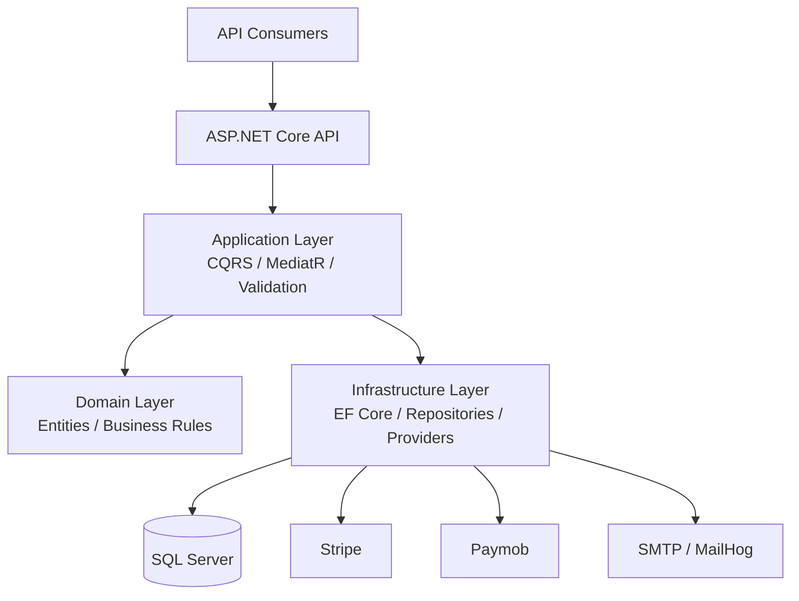

# 🏢 PropertyManagement
### Enterprise Multi-Tenant Property Management Platform

[](https://github.com/1TahaAhmed/PropertyManagement/actions/workflows/ci.yml)


**PropertyManagement** is an enterprise-oriented, multi-tenant property management backend built with **.NET 10**. It provides a structured foundation for managing real estate portfolios, organizations, properties, residential units, residents, lease lifecycles, billing, payment processing, and financial accounting.

The platform is designed around real-world business constraints: tenant isolation, role-based authorization, transactional consistency, financial traceability, concurrency control, and reliable payment workflows.

Rather than treating property management as a collection of CRUD operations, this project models it as a collection of interconnected business domains with explicit rules and lifecycle management.

---

## ✨ Core Capabilities

| Domain | Capabilities |
|---|---|
| 🏢 Organizations | Multi-organization management, memberships, invitations, and role assignment |
| 🔐 Authentication | Registration, login, JWT authentication, refresh token rotation, email confirmation, and password recovery |
| 🏘️ Properties & Units | Property and unit management, occupancy-related status management |
| 👥 Residents | Resident profiles, emergency contacts, archiving, deactivation, and blacklisting |
| 📄 Lease Management | Draft creation, submission, approval, renewal, termination, cancellation, and resident management |
| 🧾 Billing | Lease billing, recurring charge workflows, invoice generation, adjustments, overdue handling, and voiding |
| 💳 Payments | Payment intents, multiple providers, confirmation, allocation, refunds, and reconciliation |
| 📚 Financial Ledger | Double-entry journal entries, account balances, settlement postings, and reversals |
| 📋 Audit Trail | Immutable financial audit records and traceable business operations |

---

## 🏗️ Architecture

The solution follows **Clean Architecture** principles, keeping business rules independent from infrastructure concerns and external services.



### Solution Structure

```text
PropertyManagement/
│
├── src/
│   ├── PropertyManagement.Api/
│   │   ├── Authorization/
│   │   ├── Controllers/
│   │   ├── Contracts/
│   │   ├── Middleware/
│   │   └── Extensions/
│   │
│   ├── PropertyManagement.Application/
│   │   ├── Abstractions/
│   │   ├── Features/
│   │   │   ├── Authentication/
│   │   │   ├── Organizations/
│   │   │   ├── Properties/
│   │   │   ├── Residents/
│   │   │   ├── Leases/
│   │   │   ├── Billing/
│   │   │   ├── Payments/
│   │   │   └── Ledger/
│   │   ├── Common/
│   │   └── Validators/
│   │
│   ├── PropertyManagement.Domain/
│   │   ├── Entities/
│   │   ├── Enums/
│   │   └── Common/
│   │
│   └── PropertyManagement.Infrastructure/
│       ├── Persistence/
│       │   ├── Configurations/
│       │   ├── Repositories/
│       │   └── Migrations/
│       ├── Identity/
│       ├── Payments/
│       ├── Email/
│       └── Events/
│
├── tests/
│   ├── PropertyManagement.Api.Tests/
│   ├── PropertyManagement.Application.Tests/
│   ├── PropertyManagement.Domain.Tests/
│   └── PropertyManagement.IntegrationTests/
│
├── docs/
├── Dockerfile
├── docker-compose.yml
└── PropertyManagement.slnx
```

### Architectural Principles

- **Clean Architecture:** Separation between business logic, application orchestration, persistence, and delivery mechanisms.
- **CQRS:** Commands and queries have distinct responsibilities, orchestrated through MediatR.
- **Domain-Centric Design:** Business invariants and lifecycle transitions are modeled in domain entities.
- **Dependency Inversion:** Application logic depends on abstractions instead of concrete infrastructure implementations.
- **Explicit Validation:** Request validation and business-rule enforcement are handled at their appropriate layers.

---

## 🔒 Multi-Tenancy & Authorization

Multi-tenancy is a fundamental architectural concern, not an afterthought.

Each organization operates within its own logical data boundary.

Key mechanisms include:

- Organization-scoped entities and EF Core global query filters.
- Tenant context resolution from the authenticated user.
- Explicit tenant scoping for background and system-level operations.
- Organization-aware write validation.
- Cross-tenant access protection.
- Dynamic permission-based authorization.

### Role-Based Access Control

The authorization model supports:

| Role | Responsibility |
|---|---|
| Owner | Full organization administration |
| Admin | Organization and operational management |
| PropertyManager | Property, resident, lease, and selected financial operations |
| Staff | Restricted operational access |

Permissions are defined by business capabilities rather than relying exclusively on controller-level role checks.

---

## 💰 Financial Management & Accounting

One of the core engineering concerns of this project is maintaining financial consistency across billing and payment workflows.

### Billing & Invoicing

The platform supports:

- Automated lease billing.
- Charge creation and management.
- Draft invoice generation.
- Invoice issuance and numbering.
- Invoice adjustments and late fees.
- Overdue invoice lifecycle management.
- Invoice cancellation and financial reversal.

### Payment Processing

The payment domain is designed around explicit payment lifecycle transitions.

Implemented provider adapters include:

- Manual payments.
- Simulated payment provider.
- Stripe.
- Paymob.

Additional capabilities include:

- Payment intent creation.
- Provider status synchronization.
- Payment confirmation and cancellation.
- Invoice allocation strategies.
- Automatic allocation to eligible outstanding invoices.
- Partial and full refunds.
- Payment reconciliation workflows.
- Idempotency protection.

### Double-Entry Ledger

Financial operations are represented through journal entries containing debit and credit lines.

The ledger supports postings associated with:

- Invoice issuance.
- Invoice adjustments.
- Invoice voiding.
- Payment receipts.
- Provider settlements.
- Payment allocations and reversals.
- Refunds.
- Journal entry reversals.

Core accounting principles include:

- Every posted journal entry must balance.
- Posted journal entries are immutable.
- Financial corrections use reversal entries rather than silently rewriting history.
- Journal entries carry organization ownership and idempotency identifiers.
- Financial audit records preserve operation context.

### Webhooks & Reliability

Payment provider callbacks are treated as untrusted external input until verified.

The webhook pipeline includes:

- Provider signature verification.
- Timestamp-based replay protection.
- Duplicate event detection.
- Idempotent event processing.
- Transactional persistence.
- Protection against certain out-of-order payment events.
- Financial audit logging.

---

## ⚙️ Engineering & Reliability

The implementation includes several mechanisms intended to protect business operations under concurrent requests and unexpected failures.

| Concern | Implementation |
|---|---|
| Data Integrity | Database constraints and domain invariants |
| Tenant Isolation | Global query filters and organization-aware writes |
| Concurrency | Row versions, explicit locks, and transactional workflows |
| Idempotency | Unique idempotency keys and webhook event identifiers |
| Financial Integrity | Balanced journal entries and immutable posted records |
| Authentication | JWT validation and refresh token rotation |
| API Security | Dynamic permissions and authentication rate limiting |
| Error Handling | Centralized exception handling and ProblemDetails |
| Observability | Request logging and health checks |

---

## 🧰 Technology Stack

| Technology | Purpose |
|---|---|
| C# / .NET 10 | Application runtime |
| ASP.NET Core Web API | HTTP API |
| Entity Framework Core | ORM and data persistence |
| Microsoft SQL Server | Relational database |
| ASP.NET Core Identity | Identity and user management |
| JWT Bearer | API authentication |
| MediatR | CQRS and request orchestration |
| FluentValidation | Application validation |
| Docker & Docker Compose | Containerization and local development |
| GitHub Actions | Continuous integration |

---

## 🚀 Getting Started

### Prerequisites

- .NET 10 SDK
- SQL Server 2022 or compatible SQL Server instance
- Docker Desktop (optional)
- Git

### 1. Clone the Repository

```bash
git clone https://github.com/1TahaAhmed/PropertyManagement.git

cd PropertyManagement
```

### 2. Configure Secrets

The application intentionally requires a JWT signing secret.

Generate a unique random secret of at least 32 characters.

```bash
dotnet user-secrets set "Jwt:Secret" "<YOUR_SECURE_SECRET>" --project src/PropertyManagement.Api
```

Configure your SQL Server connection string:

```bash
dotnet user-secrets set "ConnectionStrings:MyConn" "<YOUR_CONNECTION_STRING>" --project src/PropertyManagement.Api
```

For a local development environment, the development configuration already includes local SMTP and SQL Express defaults. Update these settings when using different services.

Never commit production credentials or payment provider secrets.

### 3. Apply Database Migrations

```bash
dotnet ef database update \
  --project src/PropertyManagement.Infrastructure \
  --startup-project src/PropertyManagement.Api
```

### 4. Run the API

```bash
dotnet run --project src/PropertyManagement.Api
```

### 5. Explore the API

When running with the Development environment, Swagger UI is available at:

```text
https://localhost:7261/swagger
```

---

## 🐳 Running with Docker Compose

The repository includes a Docker Compose configuration for running the API, SQL Server, and MailHog.

Create your environment file:

```bash
cp .env.example .env
```

Configure the required values:

```env
MSSQL_SA_PASSWORD=YourStrongUniquePassword
JWT_SECRET=YourRandomSecretAtLeast32Characters
```

Start the stack:

```bash
docker compose up --build
```

Services:

| Service | Local URL |
|---|---|
| API | http://localhost:5000 |
| Swagger | http://localhost:5000/swagger |
| SQL Server | localhost:1433 |
| MailHog Dashboard | http://localhost:8025 |

The Development environment applies database migrations during application startup.

---

## 🧪 Testing

The solution is organized into four dedicated test projects.

```bash
dotnet test PropertyManagement.slnx
```

| Test Project | Responsibility |
|---|---|
| API Tests | Controller behavior, authorization, and HTTP contracts |
| Application Tests | CQRS handlers, validators, and workflow behavior |
| Domain Tests | Business rules, aggregate behavior, and invariants |
| Integration Tests | Persistence, tenant isolation, and cross-component workflows |

### Continuous Integration

GitHub Actions automatically performs:

1. Dependency restoration.
2. Release configuration build.
3. Unit and integration test execution.
4. Code coverage collection.
5. Docker image build verification.

[View GitHub Actions](https://github.com/1TahaAhmed/PropertyManagement/actions)

---

## 📡 API Overview

The API uses versioned REST endpoints.

| Area | Base Route |
|---|---|
| Authentication | `/api/v1/Auth` |
| Payment Intents | `/api/v1/payment-intents` |
| Payments | `/api/v1/payments` |
| Ledger Entries | `/api/v1/ledger/entries` |
| Account Balances | `/api/v1/ledger/balances` |
| Financial Audit Logs | `/api/v1/ledger/audit-logs` |
| Payment Webhooks | `/api/v1/webhooks/payments/{provider}` |

Protected endpoints require a valid JWT Bearer access token and the corresponding organization permission.

---

## 🔐 Security Notes

- JWT secrets must be configured through User Secrets or environment variables.
- Refresh tokens are generated cryptographically and stored as SHA-256 hashes.
- Authentication requires confirmed email addresses.
- Authentication endpoints have rate-limiting policies.
- Organization data must remain isolated across tenants.
- Provider webhook signatures are validated before processing.
- Secrets must never be committed to source control.

For production deployments, configure trusted reverse proxies, production SMTP, CORS origins, payment credentials, database credentials, and HTTPS termination according to the deployment environment.

---

## 📌 Project Status

PropertyManagement is an actively developed backend platform.

The repository currently contains the core architecture and implemented workflows for organization management, property operations, lease management, billing, payments, and financial ledger operations.

The project continues to evolve with a focus on correctness, maintainability, security, and realistic business behavior.

---

## 👨‍💻 Author

**Taha Ahmed**

GitHub: [@1TahaAhmed](https://github.com/1TahaAhmed)

Project Repository: [PropertyManagement](https://github.com/1TahaAhmed/PropertyManagement)

---

*Built with C#, .NET, and a focus on engineering the business rules behind real-world property management systems.*
